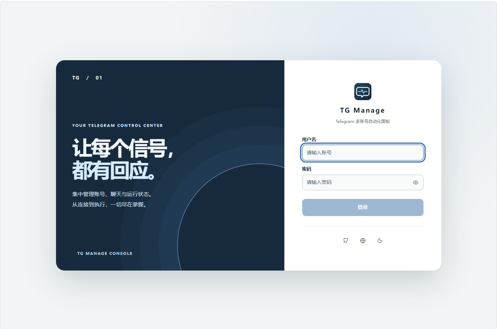
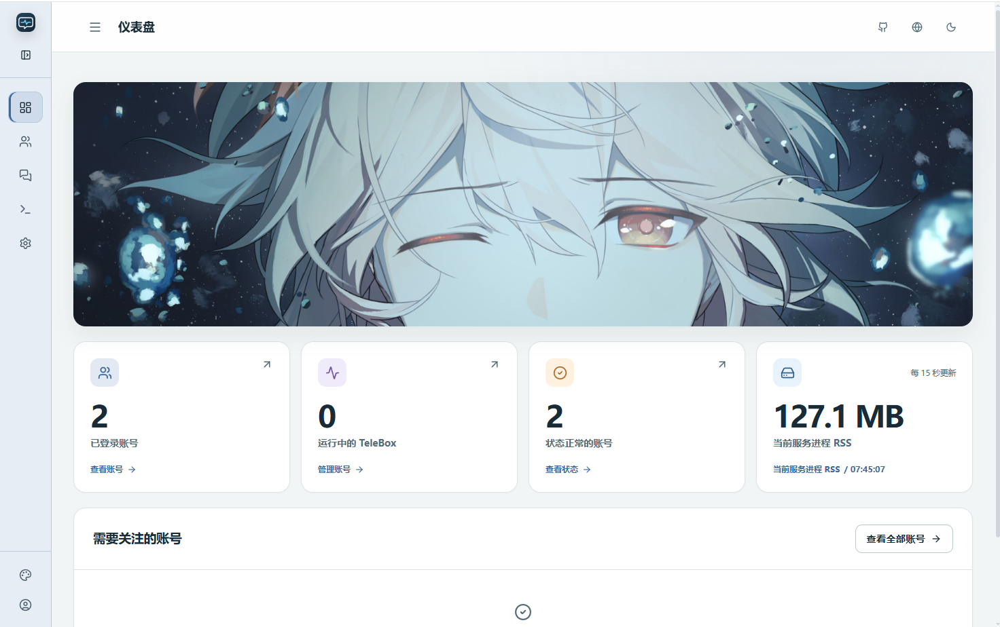
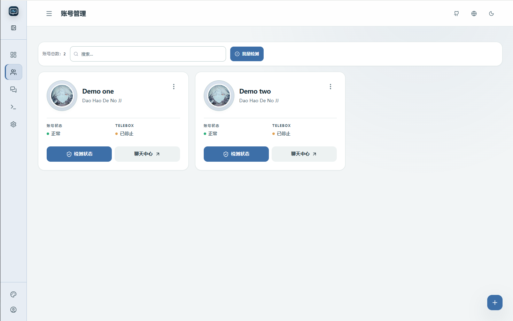
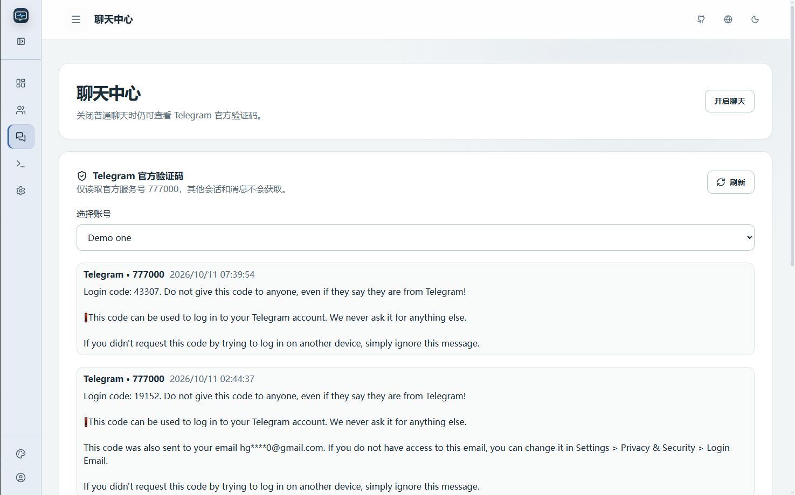
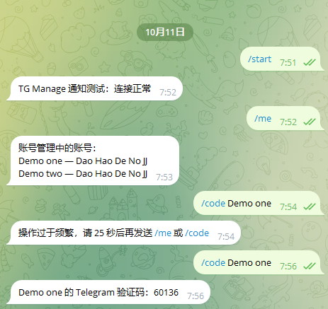

<p align="center"></p>
<h1 align="center">🚀 TG Manage</h1>
<p align="center">A focused Telegram multi-account dashboard with an isolated TeleBox runtime.</p>
<p align="center"><a href="README.md">简体中文</a> · <a href="README_EN.md"><strong>English</strong></a></p>
<p align="center"><a href="#whats-new">🆕 What's new</a> · <a href="#features">✨ Features</a> · <a href="#screenshots">🖼️ Screenshots</a> · <a href="#quick-start">🚀 Quick start</a> · <a href="#guides">📚 Guides</a> · <a href="#reference">🧰 Reference</a></p>


> Based on [Silentely/TG-SignPulse](https://github.com/Silentely/TG-SignPulse) and integrating [TeleBoxOrg/TeleBox](https://github.com/TeleBoxOrg/TeleBox). The current project is [hikling/TG-Manage](https://github.com/hikling/TG-Manage); build from this repository because upstream images do not include these UI and TeleBox changes.

<a id="whats-new"></a>
## 🆕 What's new in v2.5.0

- **Xray subscriptions and account-specific routes:** Configure an HTTPS primary subscription and an optional fallback. Each account receives an exclusive healthy node: available primary nodes first, then fallback nodes; overflow accounts use direct access. Nodes are checked every 5 minutes; a slow or failed result is rechecked after 1 minute, and two consecutive abnormal results trigger a switch. The default latency threshold is 800 ms and can be changed. Account cards show exit country, public IP, and route source. Legacy manually entered SOCKS5 settings no longer control connections.
- **Scheduled report and scoped manual checks:** At 00:00 in the configured time zone, the service checks every account and route. With Bot notifications enabled, it also reports Telegram official messages from the preceding 24 hours. A card check covers only that account's Telegram, TeleBox, and IP state; manual batch checking also cleans orphaned account and TeleBox data. The Bot connection test sends one test message only.
- **Sign-in and migration:** Account Management can export and import an encrypted `.tglogin` backup of main account authorizations. Phone-code login displays Telegram's actual delivery method and resend countdown; no delivery preference is required. The private Bot adds `/me` for numbered accounts and `/code number` for recent codes.
- **UI and resource changes:** Duplicate card-menu check/log actions, the TeleBox runtime-log page, and manual keepalive were removed. IP probes, log buffers, and avatar request state now have resource bounds.

Read the **[full v2.5.0 release guide](docs/releases/v2.5.0.md)** for timings, migration steps, and verification limits (Chinese).

<a id="features"></a>
## ✨ Features

<table>
  <tr>
    <td valign="top" width="50%">
      <h3>👥 Account management</h3>
      <p>Sign in by code or QR. A card check reads only that account's Telegram, TeleBox, and exit IP status; a manual batch check also removes orphaned account and TeleBox data on the server. Each account has an exclusive Xray node: free primary nodes are used first, then fallback nodes, with excess accounts using direct access. IP location shows the country, public IP, and current route source.</p>
    </td>
    <td valign="top" width="50%">
      <h3>💬 Chat center</h3>
      <p>Browse group conversations by account, search, send attachments, reply, edit, and delete messages. Chat can be switched on independently.</p>
    </td>
  </tr>
  <tr>
    <td valign="top" width="50%">
      <h3>🤖 Private bot</h3>
      <p>The configured private target ID may use <code>/me</code> to list numbered account names and remarks, then <code>/code 4</code> to query the fourth account's code from the last five minutes. <code>/code account-name</code> remains supported. Repeating the same complete command has a 45-second cooldown; different commands may follow immediately. Idle operation never scans account messages.</p>
    </td>
    <td valign="top" width="50%">
      <h3>🎨 Dashboard and appearance</h3>
      <p>The dashboard provides the cover, Manage accounts, and Refresh entry points. Accent colors and custom covers are saved on the server, with positioning, reset, and a 1 MiB upload limit.</p>
    </td>
  </tr>
  <tr>
    <td valign="top" width="50%">
      <h3>🔌 Integrated TeleBox</h3>
      <p>Each enabled account gets a separate Telegram session and runtime directory. Its card shows status and controls to start, stop, or log out. Redacted process errors go to the server log; the panel no longer caches per-account runtime logs. The pinned upstream revision is recorded in <a href="telebox/UPSTREAM.json"><code>telebox/UPSTREAM.json</code></a>.</p>
    </td>
    <td valign="top" width="50%">
      <h3>🔐 Separate session boundary</h3>
      <p>Logging out of TeleBox clears only its separate authorization, not the main account session. Keep the two session stores separate.</p>
    </td>
  </tr>
</table>


<a id="screenshots"></a>
## 🖼️ Screenshots

<details>
<summary><strong>View project screenshots</strong></summary>

Click an image to view the full screenshot.

<table>
  <tr>
    <th width="50%">Login</th>
    <th width="50%">Dashboard</th>
  </tr>
  <tr>
    <td align="center"><a href="docs/public/screenshots/登录.png"></a></td>
    <td align="center"><a href="docs/public/screenshots/仪表盘.png"></a></td>
  </tr>
  <tr>
    <th>Account management</th>
    <th>Chat center</th>
  </tr>
  <tr>
    <td align="center"><a href="docs/public/screenshots/账户管理.png"></a></td>
    <td align="center"><a href="docs/public/screenshots/聊天中心.png"></a></td>
  </tr>
  <tr>
    <th colspan="2">Bot verification codes</th>
  </tr>
  <tr>
    <td colspan="2" align="center"><a href="docs/public/screenshots/bot获取验证码.png"></a></td>
  </tr>
</table>

</details>

<a id="quick-start"></a>
## 🚀 Quick start

Small deployments support a minimum of 1 vCPU / 1 GiB RAM, with no artificial upper limit. Scale according to account count and actual workload. Install Docker Engine, Docker Compose v2, and Git. Ensure the server can reach Telegram and download build dependencies, then run:

```bash
git clone https://github.com/hikling/TG-Manage.git
cd TG-Manage
bash scripts/install.sh
```

The installer builds from this repository, starts the service, and prints a one-time setup token. Open `http://YOUR_SERVER_IP:8080`, enter the token, and choose an admin password of at least 12 characters. Configure an [HTTPS reverse proxy](docs/deploy/nginx.md) before exposing the service publicly.

> **⚠️ Upgrading an existing installation? Do not reinitialize or delete its data.** Run `bash scripts/update.sh` in the existing checkout. Keep the entire `data/` directory, including the hidden `data/.app_secret_key`, database, account sessions, and TeleBox data. See “Data, upgrades, and backups” below.

<a id="first-use"></a>
## 🧭 First use

1. **🔐 Set up the admin:** Enter the one-time setup token; existing installations keep their current login. Enable panel TOTP if possible.
2. **🌐 Configure subscriptions:** In Settings, save an HTTPS primary subscription and optionally a fallback, then refresh them. Account networking remains in setup-required mode until the first subscription is configured. Each healthy node serves one account; accounts beyond the available primary and fallback nodes explicitly use direct access. See the [Xray and subscription deployment notes](docs/deploy/docker.md#机场订阅与-xray).
3. **➕ Add an account:** Choose code or QR login in Account Management. An ordinary account may omit API ID/Hash; supply account-specific credentials when enabling TeleBox, and complete 2FA if prompted.
4. **🗂️ Work on demand:** A card check reads that account's status, TeleBox, and IP; a manual batch check also cleans orphaned server data. The daily 00:00 job checks all accounts and the prior 24 hours of official messages, then sends the configured Bot report. Enable chat inside the Chat Center when needed.
5. **💾 Migrate authorization when needed:** Account Management → Login Backup can manually export and import an encrypted `.tglogin` file for main account sessions. It excludes TeleBox and panel settings; stop the old server before using the same authorization on a new one. See the [login-backup guide](docs/guide/account-login-backup.md) (Chinese).

TeleBox manages its own commands and plugins. System plugins are bundled; community plugins are published in [TeleBox-Plugins](https://github.com/TeleBoxOrg/TeleBox-Plugins). See the bundled [`telebox/README.md`](telebox/README.md) for details.

<a id="guides"></a>
## 📚 Guides

- **📦 [Docker deployment and upgrades](docs/deploy/docker.md)** — Installation, backups, rollback, and build troubleshooting.
- **🧭 [Quick-start guide](docs/guide/quick-start.md)** — Initial setup and account onboarding.
- **🆕 [v2.5.0 release guide](docs/releases/v2.5.0.md)** — Features, timing, migration, and verification limits (Chinese).
- **⚙️ [Configuration reference](docs/reference/configuration.md)** — Environment variables and data paths.
- **🛠️ [Local development](docs/reference/development.md)** — Source setup and development commands.

<a id="reference"></a>
## 🧰 Reference

Expand a section only when you need its details.

<a id="environment"></a>
<details>
<summary><strong>⚙️ Environment variables</strong></summary>

| Variable | Purpose |
| --- | --- |
| `TG_MANAGE_TG_API_ID/HASH` | Optional private server credentials for ordinary accounts; use account-specific credentials for TeleBox. |
| `SIGNPULSE_TG_API_ID/HASH`, `TG_API_ID/HASH` | Legacy aliases still read during upgrades. |
| `APP_SECRET_KEY` | Authentication and credential encryption key; persisted in `data/.app_secret_key` and essential to backups. |
| `APP_DATA_DIR` | Database, sessions, logs, and TeleBox data directory; Compose uses `/data`. |
| `APP_DATABASE_URL` | Override the default SQLite connection. |
| `TG_GLOBAL_CONCURRENCY` | Limit for concurrent Telegram operations, not the total number of signed-in accounts. |
| `TELEBOX_NODE` | Select the Node 24 executable for local TeleBox development. |

See [`backend/core/config.py`](backend/core/config.py) and the [configuration reference](docs/reference/configuration.md) for all options. Never commit secrets, sessions, bot tokens, or backups.

</details>

<a id="data-upgrade-backup"></a>
<details>
<summary><strong>💾 Data, upgrades, and backups</strong></summary>

Compose bind-mounts host `./data` to container `/data`. This includes the database, account sessions, settings, logs, per-account TeleBox directories, dashboard cover, and `data/.app_secret_key`. Older installations may store the cover in `data/.signer/appearance/`. **Preserve the entire directory, including hidden files.** Without the original secret, encrypted account credentials and bot tokens cannot be decrypted.

From the existing checkout, run:

```bash
bash scripts/update.sh
```

The script uses `scripts/backup.sh` to archive the full data directory under `backups/`, runs `git pull --ff-only`, then rebuilds and starts the service. It does not remove older backups. If you changed the data directory, verify that `APP_DATA_DIR` and the Compose mount point to the same location first. Back up external PostgreSQL databases separately. See the [Docker guide](docs/deploy/docker.md#无损升级与回退) for manual steps and rollback.

To restore, stop the service, restore the full data directory, then restart and check accounts, sessions, and settings. Backups contain sensitive credentials; never publish them. TeleBox core code can be updated while user plugins, configuration, and separate sessions remain in place.

</details>

<a id="verification-limitations"></a>
<details>
<summary><strong>🧪 Verification and known limitations</strong></summary>

Local checks:

```bash
python3 -m ruff check backend tg_manage tests
python3 -m pytest -q
cd frontend && npm run typecheck && npm test && npm run build
cd ../telebox && npx tsc --noEmit
```

Real-account code and QR login, independent TeleBox authorization, Bot API access, remote plugin installation, and a complete Docker build still need verification in your deployment environment. Former scheduler and monitor data may remain on disk, but the removed actions no longer run. Allow for the additional process and session overhead of each active TeleBox account.

</details>

<a id="project-development"></a>
<details>
<summary><strong>🗂️ Project structure and development</strong></summary>

```text
TG-Manage/
├── backend/       FastAPI routes and account/message services
├── frontend/      Vue 3 management UI
├── tg_manage/     Telegram client and session utilities
├── telebox/       Upstream TeleBox source and integration adapter
├── docs/          User, deployment, and operations guides
└── tests/         Backend tests
```

Source development needs Python 3.10–3.13, Node 22.23.1 for the frontend, and Node 24 for TeleBox. See [`Dockerfile`](Dockerfile) for native module dependencies. Local AI workflows, skills, and task notes are not published with the source. TeleBox keeps its upstream [LGPL-2.1-only license](telebox/LICENSE); the rest of this project uses the root [`LICENSE`](LICENSE).

</details>
